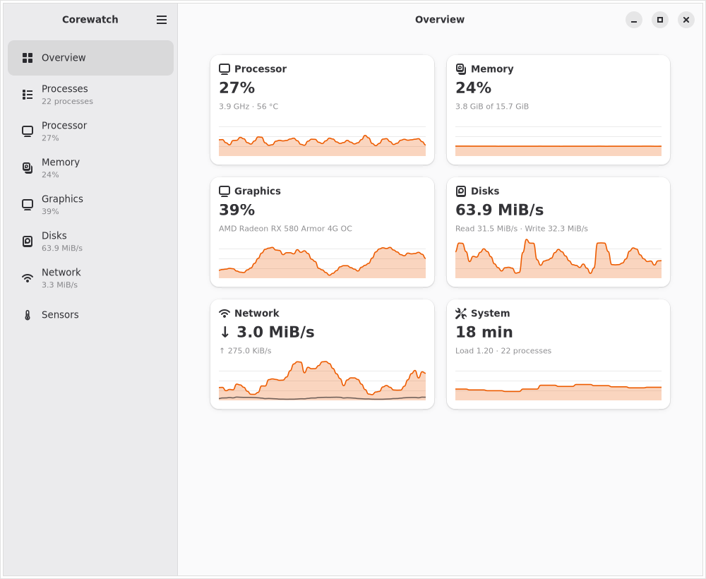
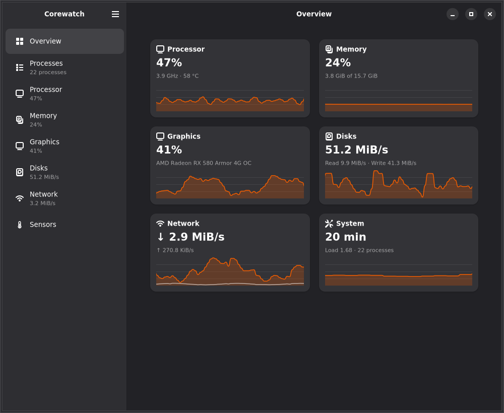
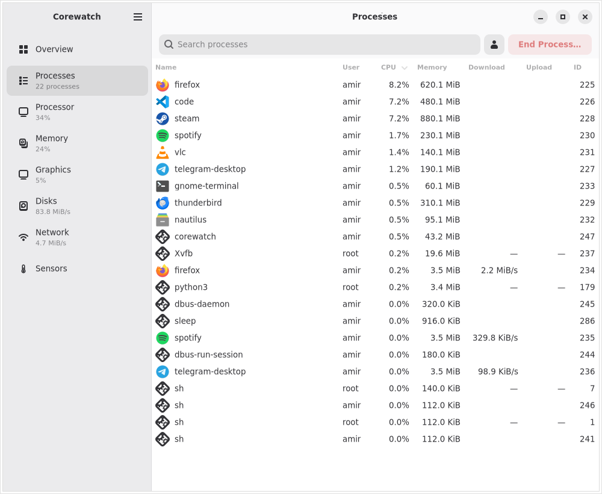
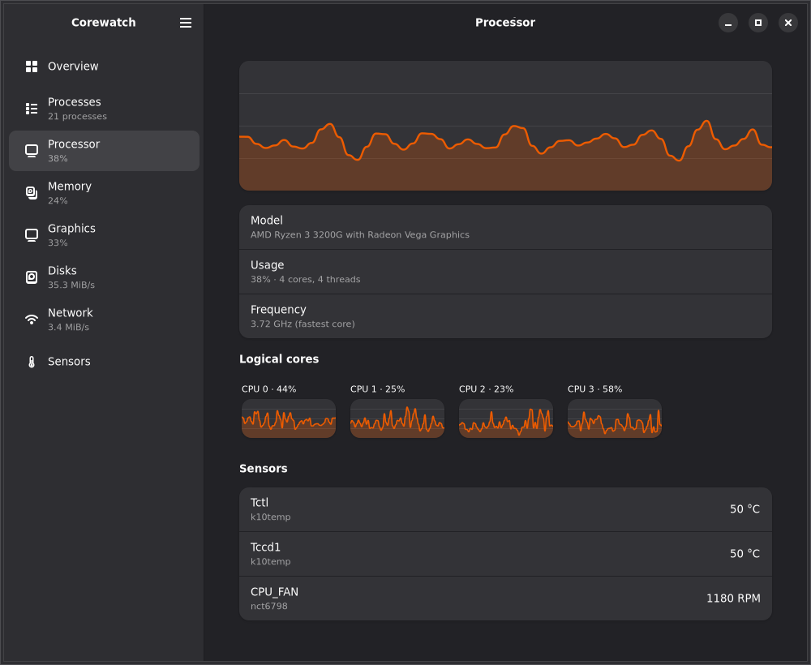
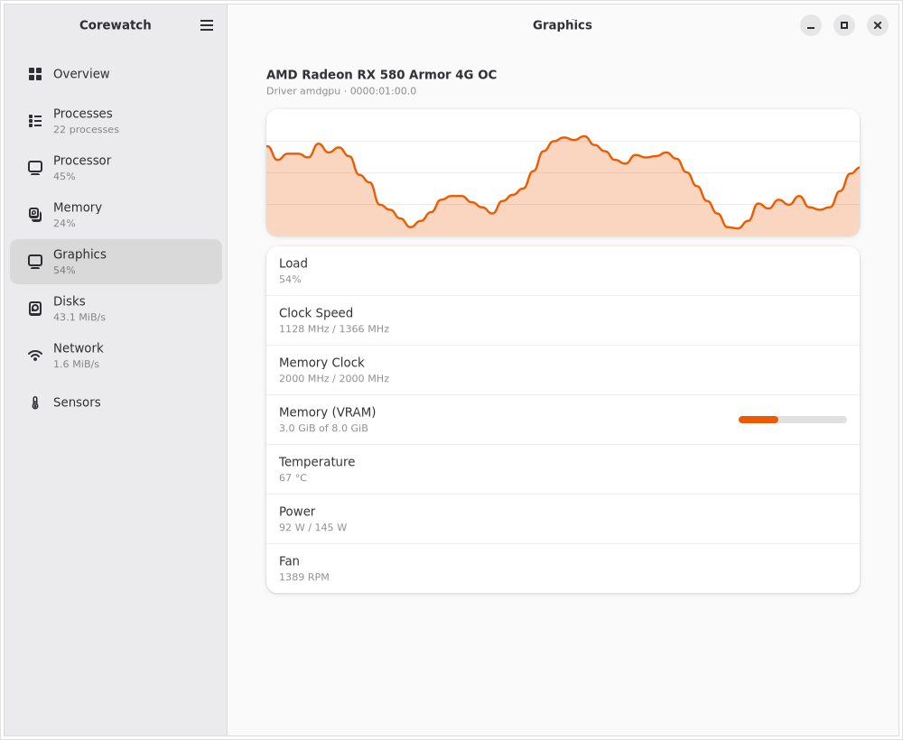
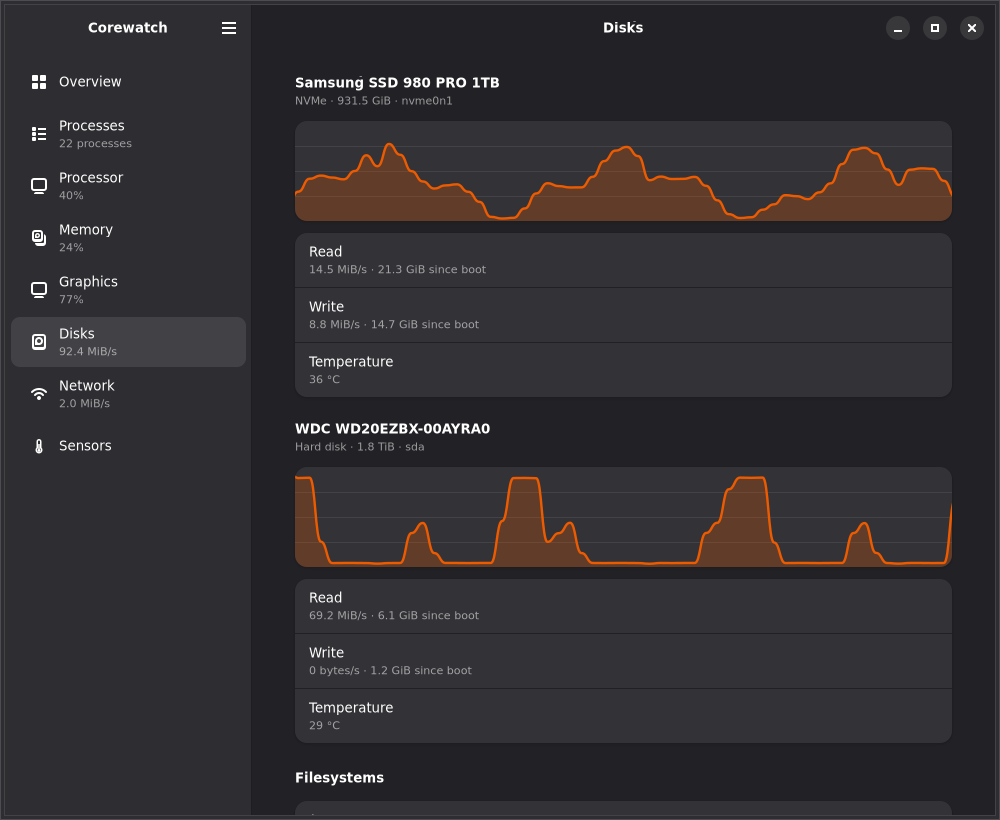
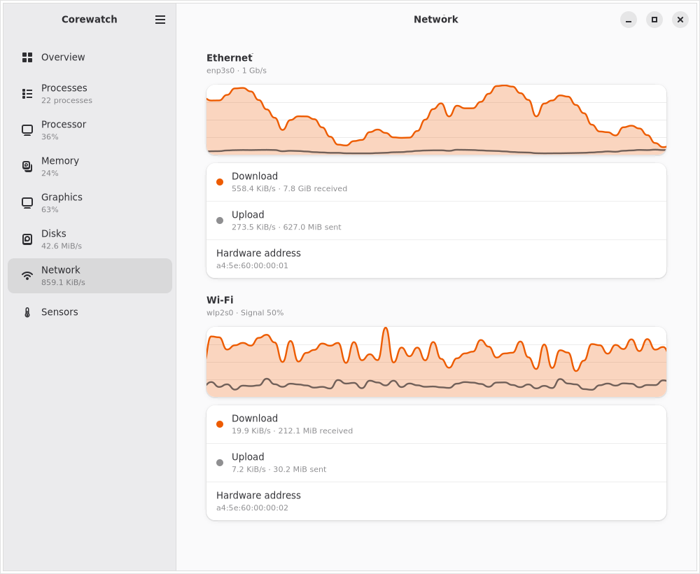

<p align="center">
  
</p>

<h1 align="center">Corewatch</h1>

<p align="center">
  <strong>Everything your Linux system is doing, in one place.</strong><br>
  A fast, native system monitor for the GNOME desktop, written in Rust with GTK 4 and libadwaita.
</p>

<p align="center">
  <a href="https://github.com/amirmwhdi/CoreWatch/releases"></a>
  <a href="LICENSE"></a>
  
  
</p>

<p align="center">
  <a href="#a-quick-tour">Tour</a> •
  <a href="#features">Features</a> •
  <a href="#install">Install</a> •
  <a href="#build-from-source">Build</a> •
  <a href="#privacy-and-permissions">Privacy</a> •
  <a href="#contributing">Contributing</a>
</p>

<p align="center">
  
  
</p>

---

Corewatch shows what your computer is doing right now: how busy the
processor and graphics card are, how much memory is in use, which drives and
network connections are working, how warm everything is, and which apps are
responsible. It reads everything straight from the Linux kernel, so it
starts in an instant and stays light while it runs.

It is made to feel at home on a modern Linux desktop. It follows your light
or dark style and your accent color, fits a phone-sized window as well as a
large monitor, and never asks for a password: everything it shows can be read
as a normal user.

> **Status: 0.3, preview.** Corewatch is young and changing quickly. Bug
> reports and ideas are very welcome in
> [Issues](https://github.com/amirmwhdi/CoreWatch/issues).

## A quick tour

### Overview

Every resource on one page, each with a live graph. Click a card to open its
page. The sidebar keeps the most important number of each page in view, so
you can watch the processor while you look at your disks.

### Processes

<p align="center">
  
</p>

Every running process with its app icon, CPU and memory use, and how fast it
is downloading and uploading. Sort by any column, search by name, show only
your own processes, and end a process (or force-stop one that does not
listen) right from the list.

### Processor

<p align="center">
  
</p>

Total usage over the last minute, a small graph for each logical core, the
processor's model, core and thread count and current frequency, and its
temperature sensors and fan.

### Graphics

<p align="center">
  
</p>

One section for each graphics card, named the way you know it ("AMD Radeon
RX 580", "GeForce RTX 3060"), with its load, core and memory clock, video
memory, temperature, power draw and fan speed. See
[which cards report what](#graphics-cards).

### Disks

<p align="center">
  
</p>

How busy each drive is, its read and write speed, its temperature, and how
full each mounted filesystem is.

### Network

<p align="center">
  
</p>

Download and upload speed of every connection, with its addresses, link speed
and Wi-Fi signal strength.

## Features

- **Overview** of every resource at a glance, with live graphs.
- **Processes:** a sortable table with app icons, CPU, memory, download and
  upload speed, user and process ID; search, "only my processes", End
  Process and Force Stop.
- **Processor:** total usage graph, one graph per logical core, model, cores
  and threads, current frequency.
- **Memory:** used, available, cache and buffers, swap, and a usage graph.
- **Graphics:** every card with its model name, driver, load graph, core and
  memory clock, video memory, temperature, power and fan.
- **Disks:** activity graph, read and write speed, temperature of each
  drive, and the space left on each mounted filesystem.
- **Network:** download and upload graph per interface, addresses, link
  speed, Wi-Fi signal.
- **Sensors:** temperatures and fan speeds appear on the page they belong to
  (CPU sensors and the CPU fan on the Processor page, drive temperatures on
  Disks, and so on); everything else, like motherboard sensors and case
  fans, is on the Sensors page.
- **Battery:** charge level graph, charging status, time remaining, health,
  power draw and charge cycles, on laptops.
- **Smooth graphs** that scroll continuously, like GNOME System Monitor. You
  can turn this off to save power.
- **Fits any screen:** the layout adapts down to 360 pixels wide.
- **Tells you when something goes wrong:** if a data source stops answering,
  a banner says so instead of showing stale numbers.

### Preferences

| Setting | Choices |
| --- | --- |
| Style | Follow the system, light, or dark |
| Update speed | Every 0.5, 1 or 2 seconds |
| Open on | A page of your choice, or the page you had open last |
| Smooth graphs | On or off |
| Temperature | °C or °F |
| Sizes | Binary (KiB, MiB) or decimal (kB, MB) |
| Network speed | Bytes or bits per second |

### Graphics cards

| Card | What Corewatch shows |
| --- | --- |
| AMD (amdgpu) | Load, core and memory clock, video memory, temperature, power, fan |
| NVIDIA, proprietary driver | Load, core and memory clock, video memory, temperature, power, fan, read through NVML (`libnvidia-ml.so.1`, which comes with the driver) |
| NVIDIA, nouveau | Temperature and fan |
| Intel (i915, xe) | Clock speed (the driver does not report load) |

A laptop's graphics card that is asleep to save power is shown as asleep and
is not woken up just to be measured.

### Good to know

- Download and upload speeds per process count TCP traffic, not UDP or QUIC.
  For other users' processes they are only shown when Corewatch runs as root.
- SATA drives show a temperature through UDisks when the kernel's
  `drivetemp` module is not loaded. UDisks refreshes it about every ten
  minutes.

## Install

Every [release](https://github.com/amirmwhdi/CoreWatch/releases) has packages
for x86_64 and aarch64 (the Arch package is x86_64 only):

| Package | For |
| --- | --- |
| `.flatpak` | Any distribution with Flatpak |
| `.deb` | Debian 13 and newer, Ubuntu 26.04 and newer |
| `.rpm` | Fedora |
| `.pkg.tar.zst` | Arch Linux and its derivatives |
| `.AppImage` | Any distribution with GTK 4.18 and libadwaita 1.7 installed |

```sh
flatpak install --user corewatch-0.3.0-x86_64.flatpak
sudo apt install ./corewatch-0.3.0-linux-amd64.deb
sudo dnf install ./corewatch-0.3.0-linux-x86_64.rpm
sudo pacman -U corewatch-0.3.0-linux-x86_64.pkg.tar.zst
```

Releases contain only installable packages: the program, its desktop entry,
icon and metainfo. Recipes for distribution repositories are in
`packaging/`: the AUR PKGBUILD and the Fedora COPR spec build from the tag
tarball GitHub serves, and the Debian package builds offline from a tarball
with vendored crates (`scripts/vendored-tarball.sh`).

## Build from source

Corewatch needs GTK 4.18 or newer, libadwaita 1.7 or newer, and a recent
stable Rust.

| Distribution | Install build dependencies |
| --- | --- |
| Arch | `sudo pacman -S --needed gtk4 libadwaita blueprint-compiler pkgconf base-devel rustup && rustup default stable` |
| Debian 13 | `sudo apt install libgtk-4-dev libadwaita-1-dev blueprint-compiler pkg-config build-essential`, then Rust from [rustup.rs](https://rustup.rs) |
| Fedora 42+ | `sudo dnf install gtk4-devel libadwaita-devel blueprint-compiler gcc`, then Rust from [rustup.rs](https://rustup.rs) |
| Ubuntu 26.04 | same as Debian |

Run it straight from the source tree:

```sh
cargo run -p corewatch --release
```

To install it with its desktop entry, icon and AppStream metadata, use Meson
(1.7 or newer):

```sh
meson setup build --prefix=/usr/local
meson compile -C build
sudo meson install -C build
```

`meson test -C build` validates the desktop entry and the metainfo when
`desktop-file-validate` and `appstreamcli` are installed.

Useful while developing:

```sh
cargo run -p corewatch -- --verbose                   # detailed logs in the terminal
COREWATCH_LOG=corewatch_core=debug cargo run -p corewatch   # custom log filter
cargo run -p corewatch-core --example print           # CPU and memory in the terminal, no GUI
COREWATCH_SYSROOT=crates/core/tests/fixtures/basic \
    cargo run -p corewatch                            # read a fake /proc and /sys
cargo test --workspace                                # tests
```

## Privacy and permissions

Corewatch reads `/proc` and `/sys` and nothing leaves your computer. It never
connects to the internet, and it needs no root password.

The Flatpak asks for a few extra permissions, each one explained in
[`packaging/flatpak/README.md`](packaging/flatpak/README.md): it reads the
host's processes, app icons and graphics card names, asks UDisks for drive
temperatures, and runs the host's `kill` when you end a process.

## Logs and bug reports

Corewatch writes a log file to `~/.local/state/corewatch/logs/` (one file per
day, the last 7 kept). Inside Flatpak the folder is under
`~/.var/app/io.github.amirmwhdi.Corewatch/`. The terminal only shows warnings
unless you pass `--verbose`.

When reporting a bug, attach today's log file. Its first lines say which
versions of Corewatch, GTK, libadwaita, the kernel and the distribution were
running, and which modules were enabled or disabled and why. Logs never leave
your computer unless you attach them yourself.

## Contributing

### Project layout

```
crates/core       corewatch-core: reads /proc and /sys, no GTK
crates/app        corewatch: the GTK app
data/ui/stable    Blueprint files for the UI, compiled into the binary
data              desktop entry, metainfo, icon (installed by Meson)
po                translation template; no translations ship yet
packaging         Flatpak manifest, Arch PKGBUILD, Debian and RPM packaging
```

The UI layout is written in
[Blueprint](https://gnome.pages.gitlab.gnome.org/blueprint-compiler/).
`crates/app/build.rs` compiles it with `blueprint-compiler` and embeds it in
the binary together with `data/style.css`, so `cargo build` alone produces a
complete program.

Every resource is a **module**: one `Collector` in `corewatch-core` that
fills one field of `Snapshot`, and one `ResourcePage` in the app that shows
it. Modules are registered in one place, `crates/app/src/modules/mod.rs`.

### Adding a module

1. `crates/core/src/<name>/`: parser with unit tests, `<Name>Sample`, `<Name>Collector`
2. `crates/core/src/lib.rs` and `snapshot.rs`: `pub mod <name>;` and one `Snapshot` field
3. `crates/app/src/modules/<name>.rs`: the page and `pub const MODULE`
4. `crates/app/src/modules/mod.rs`: `pub mod <name>;` and `<name>::MODULE` in `all()`

The window and the sampler never change when a module is added.

## License

Corewatch is free software, released under the GNU General Public License,
version 3 or any later version. See [LICENSE](LICENSE).

Copyright © 2026 Amirmahdi ([@amirmwhdi](https://github.com/amirmwhdi))
